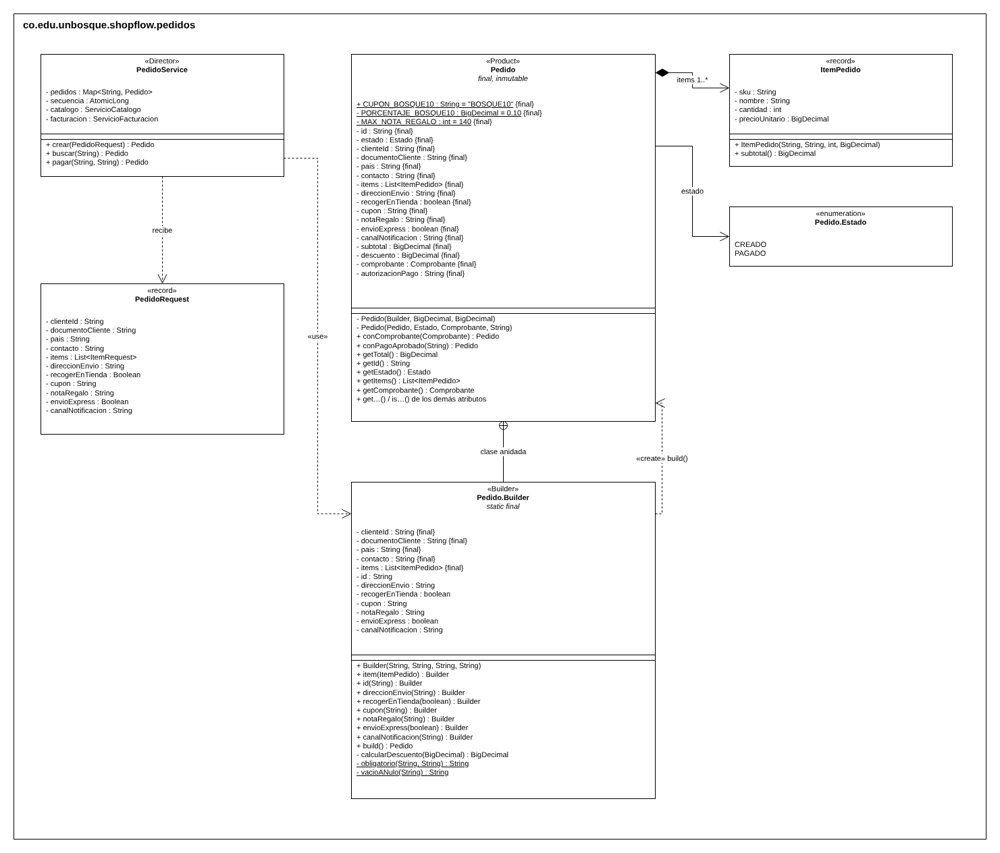
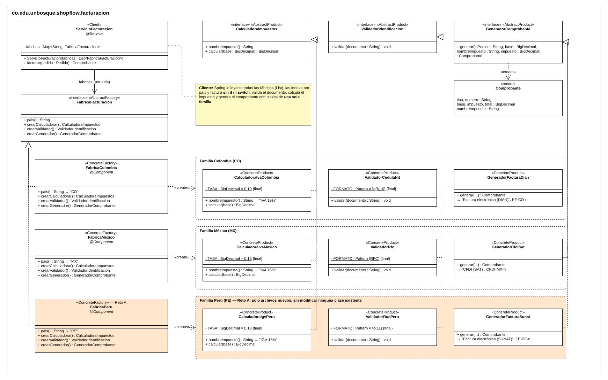
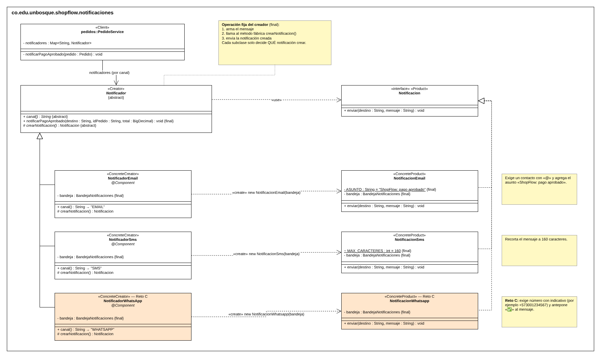
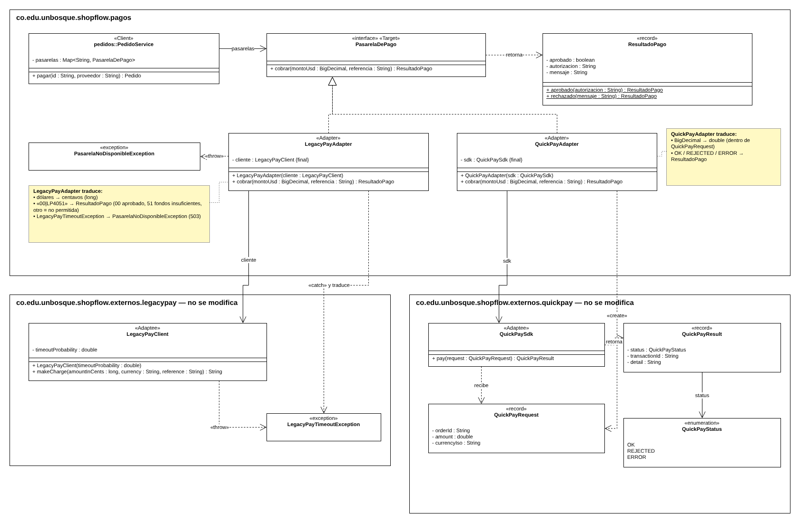
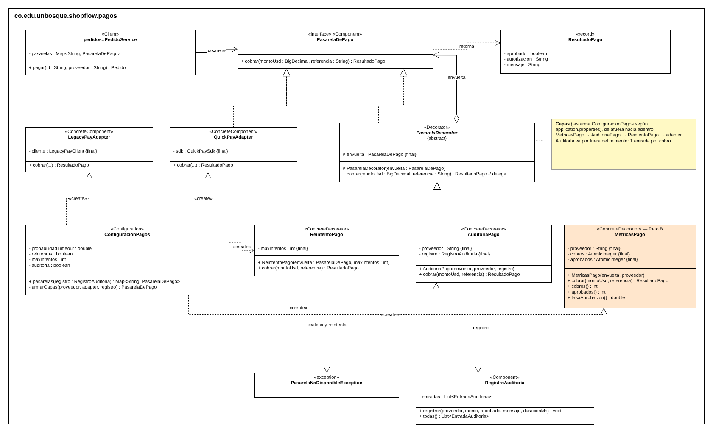
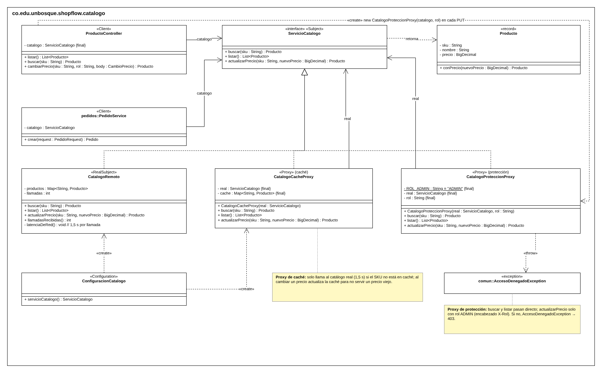

# ShopFlow · API REST con patrones de diseño

**Ingeniería de Software 2** · Taller: patrones de diseño creacionales y estructurales en una API REST
Universidad El Bosque · Facultad de Ingeniería · Periodo 2026-2

---

## 1. Integrantes, roles y ejecución

| Integrante | Rol | Patrones a cargo | Reto de extensión |
|---|---|---|---|
| Camila Valentina Martínez Cantor | A | Builder · Abstract Factory | A · Perú |
| Sophia Mateus Ruiz | B · Integradora | Adapter · Decorator | B · Métricas |
| Anderson Oswaldo Gamba Cubillos | C | Proxy · Factory Method | C · WhatsApp |

### Cómo ejecutar

Requisitos: **Java 17** o superior y **Maven** (o un IDE con soporte para Maven).

```bash
mvn spring-boot:run      # levanta la API en http://localhost:8080
mvn test                 # corre las pruebas unitarias (JUnit 5)
```

- **Swagger UI:** http://localhost:8080/swagger-ui.html
- **Guion de pruebas (Anexo B):** con la aplicación recién iniciada, ejecutar `guion-pruebas.bat` desde la raíz del proyecto. Guarda la salida de cada escenario en `evidencias/escenario-N.txt` (los cuerpos JSON están en la carpeta `guion/`).

### Configuración (`application.properties`)

| Propiedad | Valor | Efecto |
|---|---|---|
| `shopflow.legacypay.probabilidad-timeout` | `0.3` | Probabilidad de que LegacyPay falle con timeout |
| `shopflow.pagos.reintentos` | `true` | Activa la capa `ReintentoPago` |
| `shopflow.pagos.max-intentos` | `3` | Intentos antes de responder 503 |
| `shopflow.pagos.auditoria` | `true` | Activa la capa `AuditoriaPago` |

### Estructura

```
src/main/java/co/edu/unbosque/shopflow/
├── catalogo/        Proxy (caché y protección) · ProductoController
├── pedidos/         Builder (Pedido) · PedidoService · PedidoController
├── facturacion/     Abstract Factory (fábricas por país)
├── pagos/           Adapter · Decorator · auditoría
├── notificaciones/  Factory Method (notificadores por canal)
├── comun/           ManejadorErrores (excepciones → códigos HTTP)
├── config/          Swagger
└── externos/        SDK simulados de LegacyPay y QuickPay (sin cambios)
```

---

## 2. Tabla de análisis de patrones (Anexo D)

| Patrón | Problema en ShopFlow (síntoma) | Participantes GoF → clases | Principio SOLID | Cuándo no usarlo |
|---|---|---|---|---|
| *Ejemplo: Strategy* | *El costo de envío se calcula con un switch por tipo que crece con cada opción nueva.* | *Strategy: EstrategiaEnvio. ConcreteStrategy: EnvioEstandar, EnvioExpress. Context: ServicioEnvio.* | *OCP y DIP.* | *Si solo hay dos variantes que casi nunca cambian, un if es más claro.* |
| **Factory Method** | `PedidoService` decidía con un `if` por canal si hacer `new NotificacionEmail()` o `new NotificacionSms()`; cada canal nuevo obligaba a modificarlo. | Product: `Notificacion` · ConcreteProduct: `NotificacionEmail`, `NotificacionSms` · Creator: `Notificador` (`notificarPagoAprobado` + método fábrica `crearNotificacion`) · ConcreteCreator: `NotificadorEmail`, `NotificadorSms` | OCP, DIP, SRP | Cuando hay un solo producto que no cambia: la jerarquía de creadores es más compleja que el `new` que reemplaza. |
| **Abstract Factory** | Cada país exige impuesto, validación de documento y comprobante que deben ir juntos; con `if (pais.equals("CO"))` repetido es fácil mezclar piezas de dos países y abrir Perú obliga a editar cada `if`. | AbstractFactory: `FabricaFacturacion` · ConcreteFactory: `FabricaColombia`, `FabricaMexico` · AbstractProduct: `CalculadoraImpuestos`, `ValidadorIdentificacion`, `GeneradorComprobante` · ConcreteProduct: `CalculadoraIvaColombia`, `ValidadorCedulaNit`, `GeneradorFacturaDian` (y sus equivalentes de México) · Client: `ServicioFacturacion` | OCP, DIP | Cuando no hay familias (un solo producto) o cuando la familia cambia de forma: agregar un producto obliga a modificar la interfaz y todas las fábricas. |
| **Builder** | Un pedido tiene 4 datos obligatorios, ítems y 6 opciones con reglas cruzadas; con un constructor de 11 parámetros es fácil invertir dos `String` y con setters el pedido existe a medias. | Product: `Pedido` (inmutable, constructor privado) · Builder: `Pedido.Builder` (versión de Bloch) · Director: `PedidoService.crear()` | SRP | Para objetos con dos o tres parámetros obligatorios: el builder duplica código sin aportar (por eso `ItemPedido` es un `record`). |
| **Adapter** | LegacyPay cobra en centavos y responde `"00\|LP4051"`; QuickPay recibe `double` y responde un enum. Los SDK no se pueden modificar y sus formatos no deben llegar al dominio. | Target: `PasarelaDePago` · Adapter: `LegacyPayAdapter`, `QuickPayAdapter` · Adaptee: `LegacyPayClient`, `QuickPaySdk` · Client: `PedidoService` | DIP, SRP, OCP | Cuando se controlan ambas interfaces (es más simple alinearlas) o cuando la intención es simplificar un subsistema completo (eso es Facade). |
| **Decorator** | LegacyPay falla el 30 % de las veces y auditoría exige registrar cada cobro; con herencia harían falta 6 subclases (2 proveedores × 3 combinaciones) que se duplican con cada capa nueva. | Component: `PasarelaDePago` · ConcreteComponent: los adapters · Decorator: `PasarelaDecorator` · ConcreteDecorator: `ReintentoPago`, `AuditoriaPago`, `MetricasPago` | OCP, SRP, LSP | Cuando las combinaciones son pocas y fijas, cuando el cliente depende de tipos concretos o cuando una capa necesita saber qué otras hay en la cadena. |
| **Proxy** | El catálogo es de otro equipo y tarda 1,5 s por consulta (un pedido de 3 productos tardaba 4,5 s), y solo un administrador puede cambiar precios. | Subject: `ServicioCatalogo` · RealSubject: `CatalogoRemoto` · Proxy: `CatalogoCacheProxy` (caché), `CatalogoProteccionProxy` (protección) · Client: `ProductoController`, `PedidoService` | SRP, OCP, LSP | Cuando el objeto real es barato y local, cuando se necesitan datos siempre frescos sin forma de invalidar la caché, o cuando ocultar la red haría creer que una llamada es barata. |

---

## 3. Patrones implementados

### 3.1 Builder · `pedidos`

**Problema.** El pedido tiene datos obligatorios (cliente, documento, país, contacto, al menos un ítem) y opciones con reglas que cruzan varios campos: la dirección es obligatoria si no se recoge en tienda, recoger en tienda y envío express son incompatibles y la nota de regalo admite máximo 140 caracteres. `Pedido` es inmutable y solo se crea con `Pedido.Builder`, cuyo `build()` valida todas las reglas en un solo lugar: nunca existe un pedido inválido.



**Endpoint:** `POST /api/pedidos` (201 con el pedido · 400 si se rompe una regla) y `GET /api/pedidos/{id}`.
**Evidencia:** `evidencias/escenario-3.txt` (cupón BOSQUE10) y `escenario-4.txt` (sin ítems; tienda + express).

### 3.2 Abstract Factory · `facturacion`

**Problema.** Colombia factura con IVA 19 %, cédula o NIT y factura electrónica de la DIAN; México con IVA 16 %, RFC y CFDI del SAT. Las tres piezas deben ser del mismo país. `ServicioFacturacion` recibe todas las fábricas (`List<FabricaFacturacion>`), las indexa por país y factura sin conocer ninguna clase concreta, sin `if` ni `switch` por país.



**Endpoint:** el comprobante se incluye en la respuesta de `POST /api/pedidos`.
**Evidencia:** `evidencias/escenario-3.txt` (DIAN, IVA 19 %) y `escenario-5.txt` (CFDI, IVA 16 %; México con cédula colombiana → 400).

### 3.3 Factory Method · `notificaciones`

**Problema.** Cuando se aprueba un pago se notifica al cliente por el canal que eligió. El proceso es siempre el mismo (armar el mensaje, crear la notificación y enviarla); lo que cambia es la notificación: el correo exige un contacto con «@» y lleva asunto, el SMS se recorta a 160 caracteres. `Notificador.notificarPagoAprobado(...)` es `final` y llama al método fábrica `crearNotificacion()`, que cada subclase implementa. `PedidoService` recibe `List<Notificador>`, los indexa por canal y no contiene ningún `new Notificacion…` ni `if` por canal.



**Endpoint:** `GET /api/notificaciones`. Crear un pedido con un canal no soportado responde 400.
**Evidencia:** `evidencias/escenario-8.txt` (una notificación por pago aprobado, en el canal del pedido).

### 3.4 Adapter · `pagos`

**Problema.** ShopFlow cobra con dos proveedores cuyos SDK no se pueden modificar y no coinciden entre sí ni con ShopFlow. Cada adapter implementa `PasarelaDePago` y traduce en tres sentidos: la **entrada** (dólares `BigDecimal` → centavos `long` en LegacyPay; `BigDecimal` → `double` en QuickPay), la **salida** (`"00|LP4051"` o el enum `OK/REJECTED/ERROR` → `ResultadoPago`) y los **errores** (`LegacyPayTimeoutException` → `PasarelaNoDisponibleException`, que la API responde como 503). Ninguna clase fuera de los adapters, salvo `ConfiguracionPagos`, importa algo del paquete `externos`.



**Endpoint:** `POST /api/pedidos/{id}/pago` con `{"proveedor": "LEGACYPAY"}` o `{"proveedor": "QUICKPAY"}`.
**Evidencia:** `evidencias/escenario-6.txt` y `escenario-7.txt` (más de 2.000 USD con LegacyPay → 409 «Fondos insuficientes»; el mismo pedido con QuickPay → 200, sin cambiar `PedidoService`).

### 3.5 Decorator · `pagos`

**Problema.** Hay que reintentar los cobros de LegacyPay, auditar todos los cobros de los dos proveedores y poder apagar los reintentos en pruebas. Cada capa es un decorador que **es** una `PasarelaDePago` y **tiene** una `PasarelaDePago` (la envuelta), así que se apilan en cualquier orden y el cliente no distingue una pasarela decorada de una sin decorar. `ConfiguracionPagos` es el único lugar que conoce las clases concretas y arma las capas según `application.properties`: `Métricas(Auditoría(Reintento(Adapter)))`.



**Endpoint:** `GET /api/pagos/auditoria`.
**Evidencia:** `evidencias/escenario-8.txt` (exactamente una entrada de auditoría por cobro). En una simulación de 1.000 cobros con LegacyPay al 30 % de fallos, sin reintentos se aprobó el 69,3 % y con 3 intentos el 97,8 % (el teórico es 1 − 0,3³ ≈ 97,3 %).

### 3.6 Proxy · `catalogo`

**Problema.** `CatalogoRemoto` simula un servicio de otro equipo que tarda 1,5 s por llamada y no se puede modificar, y cambiar un precio es una operación restringida al rol ADMIN. Los dos proxies implementan `ServicioCatalogo`, así que ningún cliente sabe si habla con el objeto real o con un intermediario. `ConfiguracionCatalogo` entrega `new CatalogoCacheProxy(new CatalogoRemoto())` como el `ServicioCatalogo` de toda la aplicación, y `ProductoController` envuelve el catálogo en el proxy de protección con el rol del encabezado `X-Rol`.



**Endpoint:** `GET /api/productos`, `GET /api/productos/{sku}` (caché) y `PUT /api/productos/{sku}/precio` (protección: 403 sin rol ADMIN).
**Evidencia:** `evidencias/escenario-1.txt` (primera consulta ≈ 1,5 s; la segunda ≈ 0 s) y `escenario-2.txt` (CLIENTE → 403, ADMIN → 200 y la consulta siguiente muestra el precio nuevo).

### 3.7 Pruebas unitarias (JUnit 5)

| Rol | Prueba | Qué demuestra |
|---|---|---|
| A | `PedidoBuilderTest` | El builder no entrega pedidos inválidos y aplica el cupón BOSQUE10 |
| A | `FacturacionPeruTest` | La familia de Perú (reto A) calcula el IGV del 18 %, valida RUC de 11 dígitos y genera la factura SUNAT |
| B | `LegacyPayAdapterTest` | El adapter traduce montos, respuestas y errores; la excepción ajena no se filtra al dominio |
| B | `ReintentoPagoTest`, `AuditoriaPagoTest`, `MetricasPagoTest` | Cada decorador agrega su comportamiento y delega en la pasarela envuelta |
| C | `CatalogoCacheProxyTest` (con Mockito) | La segunda búsqueda de un mismo SKU no llega al catálogo real; un SKU distinto sí lo consulta |

---

## 4. Retos de extensión

Los retos comprueban que el diseño está **abierto a la extensión y cerrado a la modificación**. Cada reto se hizo en un commit propio; la evidencia es la salida de `git diff --stat` de ese commit, guardada en `evidencias/`.

| Reto | Qué se hizo | Archivos | Se modificó |
|---|---|---|---|
| **A · Perú** (Abstract Factory) | `FabricaPeru` con IGV 18 %, RUC de 11 dígitos y «Factura electrónica (SUNAT)». Un pedido con `"pais": "PE"` se factura correctamente. | `FabricaPeru`, `CalculadoraIgvPeru`, `ValidadorRucPeru`, `GeneradorFacturaSunat` (nuevos) | Nada |
| **B · Métricas** (Decorator) | Decorador `MetricasPago`: cuenta los cobros y los aprobados de cada pasarela y escribe en consola la tasa de aprobación después de cada cobro. | `MetricasPago`, `MetricasPagoTest` (nuevos) | Solo `ConfiguracionPagos` (una línea, para agregar la capa) |
| **C · WhatsApp** (Factory Method) | `NotificadorWhatsApp` y `NotificacionWhatsapp`: exige un número con indicativo (por ejemplo, `+573001234567`) y antepone «✅» al mensaje. Un pedido con `"canalNotificacion": "WHATSAPP"` se notifica. | `NotificadorWhatsApp`, `NotificacionWhatsapp` (nuevos) | Nada |

**Reto A** · `evidencias/reto-A-diff.txt`
```
 .../shopflow/facturacion/CalculadoraIgvPeru.java   | 19 +++++++++++++++
 .../unbosque/shopflow/facturacion/FabricaPeru.java | 27 ++++++++++++++++++++++
 .../facturacion/GeneradorFacturaSunat.java         | 20 ++++++++++++++++
 .../shopflow/facturacion/ValidadorRucPeru.java     | 16 +++++++++++++
 4 files changed, 82 insertions(+)
```

**Reto B** · `evidencias/reto-B-diff.txt`
```
 .../shopflow/pagos/ConfiguracionPagos.java         |  3 +-
 .../edu/unbosque/shopflow/pagos/MetricasPago.java  | 46 ++++++++++++++++++++++
 .../unbosque/shopflow/pagos/MetricasPagoTest.java  | 44 +++++++++++++++++++++
 3 files changed, 92 insertions(+), 1 deletion(-)
```

**Reto C** · `evidencias/reto-C-diff.txt`
```
 .../notificaciones/NotificacionWhatsapp.java       | 19 +++++++++++++++++
 .../notificaciones/NotificadorWhatsApp.java        | 24 ++++++++++++++++++++++
 2 files changed, 43 insertions(+)
```

---

## 5. Preguntas de reflexión

**1. ¿Cómo habría quedado `PedidoService` sin Factory Method ni Abstract Factory? ¿Cuántos `if` tendría y qué clases habría que modificar para abrir Perú y agregar WhatsApp?**

Habría tenido al menos cuatro bloques condicionales: uno por país para elegir la tasa de impuesto, otro para validar el documento, otro para generar el comprobante y uno por canal para hacer `new NotificacionEmail()` o `new NotificacionSms()`, más la validación de canales soportados. Con dos países y dos canales son unas diez ramas, y cada una crece con cada país o canal nuevo:

```java
if (pais.equals("CO")) impuesto = base.multiply(IVA_19);
else if (pais.equals("MX")) impuesto = base.multiply(IVA_16);
// … el mismo if para validar el documento y para generar el comprobante
if (canal.equals("EMAIL")) new NotificacionEmail(...).enviar(...);
else if (canal.equals("SMS")) new NotificacionSms(...).enviar(...);
```

Abrir Perú obligaría a modificar `PedidoService` en los tres `if` de facturación (con el riesgo de olvidar uno y mezclar el IGV con el comprobante de otro país), y agregar WhatsApp obligaría a modificarlo otra vez. Con los patrones, los dos retos se resolvieron con **solo archivos nuevos**: `git diff --stat` de los retos A y C no muestra ninguna clase existente modificada.

**2. ¿Por qué las notificaciones usan Factory Method y la facturación usa Abstract Factory?**

Porque una notificación es **un solo producto**: en cada caso se crea una `Notificacion` y lo único que varía es cuál, decisión que toma una subclase del creador (herencia). La facturación, en cambio, necesita **una familia de productos** que deben ser coherentes entre sí: la calculadora, el validador y el generador tienen que ser del mismo país. Si cada pieza se creara con su propio método fábrica, nada impediría combinar el IVA de Colombia con el CFDI de México. Abstract Factory lo garantiza por diseño: `ServicioFacturacion` recibe **una** fábrica (composición) y todo lo que obtiene de ella pertenece a la misma familia.

**3. Si se invierte el orden de los decoradores (reintento por fuera de la auditoría), ¿qué cambia en `GET /api/pagos/auditoria`? ¿Qué orden conviene y por qué?**

Con la auditoría **por dentro** del reintento, cada intento pasa por `AuditoriaPago`, así que se registra una entrada por **intento** y no por cobro: los timeouts aparecen como entradas fallidas seguidas de la entrada aprobada del reintento. En una simulación con las clases reales y LegacyPay al 30 % de fallos, 20 cobros produjeron **20 entradas** con `Auditoria(Reintento(Adapter))` y **30 entradas** con `Reintento(Auditoria(Adapter))`; con cinco pedidos se esperan en promedio unas 7 entradas en lugar de 5. Además, la duración registrada deja de incluir el tiempo total de los reintentos.

Conviene la auditoría **por fuera**, porque el requisito es registrar cada **cobro**: una entrada por pago del cliente, con su resultado final y su duración real. La auditoría por dentro solo sería útil para un registro técnico que quiera ver cada intento contra el proveedor.

**4. `CatalogoCacheProxy` y `AuditoriaPago` tienen casi la misma estructura: implementan la interfaz y envuelven un objeto. ¿Por qué uno es Proxy y el otro Decorator?**

La diferencia es la **intención**. `AuditoriaPago` agrega una responsabilidad nueva que el cliente quiere (registrar el cobro) y siempre delega en el objeto envuelto; además, está pensado para apilarse con otras capas en cualquier orden. `CatalogoCacheProxy` **controla el acceso** al objeto real: decide si hace falta llamarlo o si responde sin tocarlo, igual que `CatalogoProteccionProxy` decide si deja pasar la llamada según el rol. El Decorator enriquece el comportamiento; el Proxy administra cuándo, cómo y si se llega al sujeto real.

**5. Si otro sistema cambia un precio directamente en el catálogo remoto, ¿qué problema tiene la caché del proxy? Proponga una solución.**

La caché no se entera: `CatalogoCacheProxy` solo actualiza su copia cuando el cambio pasa por él (`actualizarPrecio`). Si el precio cambia en el catálogo remoto por otro camino, el proxy seguiría sirviendo el precio viejo indefinidamente, y los pedidos se cobrarían con ese valor. Soluciones posibles:

- **Expiración (TTL):** guardar con cada producto la hora en que se consultó y volver a llamar al catálogo cuando pasen, por ejemplo, cinco minutos. Es la más simple y acota el tiempo que un precio puede estar desactualizado.
- **Invalidación por evento:** que el equipo del catálogo publique un evento (webhook o cola de mensajes) cuando cambia un precio y que el proxy elimine esa entrada.
- **Precio fresco al cobrar:** usar la caché para consultar, pero pedir el precio al catálogo real al crear el pedido, que es el momento en que un precio viejo cuesta dinero.

**6. `QuickPayAdapter` convierte `BigDecimal` a `double`. ¿Qué riesgo trae y por qué conviene que esa decisión viva en el adapter y no en el dominio?**

`double` usa representación binaria y no puede guardar con exactitud la mayoría de los decimales. Por ejemplo, `19.99 * 100` en `double` da `1998.9999999999998`; convertido a entero serían 1.998 centavos y no 1.999. Con dinero eso significa cobros con un centavo de diferencia o comparaciones que fallan. (`LegacyPayAdapter` evita el problema convirtiendo a centavos con `BigDecimal.movePointRight(2)`).

Conviene que la conversión viva en el adapter porque así la imprecisión queda **encerrada en la frontera** con el código ajeno: el dominio sigue trabajando con `BigDecimal` exacto y la pérdida ocurre en un solo lugar, visible y documentado, justo antes de entregarle el monto al SDK que lo exige. Si QuickPay cambia su SDK para aceptar decimales exactos, solo se modifica el adapter.

**7. ¿En qué parte del proyecto no convenía aplicar un patrón?**

- **`ItemPedido`** es un `record` con cuatro datos obligatorios y validación en su constructor compacto. Un Builder ahí no aporta nada: el Anexo A indica que no conviene para objetos con pocos parámetros, todos obligatorios.
- **El cupón** se resuelve con una condición dentro de `Pedido.Builder`: hay un solo cupón (BOSQUE10). Un Strategy de descuentos sería una jerarquía para una sola variante; si llegan más cupones con reglas distintas, ahí sí valdría la pena.
- **`BandejaNotificaciones` y `RegistroAuditoria`** son listas en memoria sin variantes: envolverlas en fábricas o interfaces solo agregaría indirección.
- **Los controllers** solo traducen HTTP a llamadas al servicio; no tienen variación que justifique un patrón.

**8. Para cada patrón, ¿qué principio SOLID aplica? Cite la clase o la línea que lo evidencia.**

| Patrón | Principio | Evidencia en el código |
|---|---|---|
| Builder | **SRP** | `Pedido` solo representa el pedido; todas las reglas de construcción están en `Pedido.Builder.build()` (`if (recogerEnTienda && envioExpress) throw new IllegalArgumentException(...)`). |
| Abstract Factory | **OCP · DIP** | `ServicioFacturacion(List<FabricaFacturacion> fabricas)` depende de la interfaz y no tiene `if` por país; Perú se agregó con `FabricaPeru` sin modificar nada. |
| Factory Method | **OCP · DIP** | `PedidoService` guarda `Map<String, Notificador> notificadores` y llama `n.notificarPagoAprobado(...)`; WhatsApp se agregó con `NotificadorWhatsApp` sin modificar nada. |
| Adapter | **DIP · SRP** | `PedidoService` depende de `PasarelaDePago` y no importa nada de `externos`; toda la traducción de LegacyPay vive en `LegacyPayAdapter.cobrar(...)`. |
| Decorator | **OCP · SRP · LSP** | `ReintentoPago extends PasarelaDecorator` solo reintenta; `AuditoriaPago` solo registra; cualquiera de ellos sustituye a una `PasarelaDePago` en el `Map`. El reto B solo tocó `ConfiguracionPagos`. |
| Proxy | **SRP · LSP** | `CatalogoCacheProxy implements ServicioCatalogo`: la caché salió de `CatalogoRemoto` (que no se modificó) y `ConfiguracionCatalogo` es el único lugar que sabe que existe; los clientes reciben un `ServicioCatalogo`. |

---

## 6. Conclusiones y dificultades

### Conclusiones

- Los patrones no hicieron que la API funcionara (eso se podía lograr con `if` y `new`); hicieron que **siguiera siendo fácil de cambiar**. Los tres retos lo demostraron: Perú, métricas y WhatsApp se agregaron sin modificar clases existentes, salvo la línea permitida en `ConfiguracionPagos`.
- **Programar contra interfaces** fue la idea que conectó todo: `PasarelaDePago`, `ServicioCatalogo`, `Notificador` y `FabricaFacturacion` permitieron cambiar o envolver implementaciones sin que `PedidoService` se enterara.
- Los patrones de la ronda 2 se apoyaron en los de la ronda 1: el Decorator envuelve a los adapters (y el reintento funciona con los dos proveedores porque el Adapter traduce las excepciones), la facturación usa el `Pedido` del Builder y las notificaciones se disparan cuando se aprueba un pago.
- Adapter, Decorator y Proxy tienen una estructura casi idéntica; lo que los distingue es la intención: convertir una interfaz, agregar comportamiento o controlar el acceso.
- Cada patrón tiene un costo en clases e indirección. Por eso fue igual de importante decidir dónde **no** aplicarlos (pregunta 7).

### Dificultades

- **Versiones de Spring Boot mezcladas.** Al agregar Swagger se usó una versión de springdoc para Spring Boot 4 en un proyecto con Spring Boot 3.3.5, y la aplicación no arrancaba (`conventionErrorViewResolver` duplicado). Se resolvió usando `springdoc-openapi-starter-webmvc-ui` 2.6.0.
- **Integración de ramas.** Al unir las ramas, `LegacyPayAdapter` quedó pegado como clase interna de `AuditoriaController` y dos pruebas quedaron copiadas dentro de `src/main`, lo que impedía compilar. Se corrigió durante la integración.
- **Código que no llegó al repositorio.** Algunos commits subieron archivos de compilación y del IDE (`bin/`, `target/`, `.project`, `.settings/`) en lugar del código fuente; en particular, el código de Proxy y Factory Method no quedó en sus ramas y se completó durante la integración. Se agregó un `.gitignore` y se retiraron esos archivos del repositorio.
- **Reto C.** La primera versión del reto agregaba un endpoint de prueba (`POST /api/notificaciones/prueba`) modificando `NotificacionController`, lo que contradecía la regla de «solo archivos nuevos». Se integraron únicamente `NotificadorWhatsApp` y `NotificacionWhatsapp`, y la prueba se hace creando un pedido con `"canalNotificacion": "WHATSAPP"`.
- **Archivos que no se debían modificar.** Durante el trabajo se alteró `CatalogoRemoto` (se le borró el comentario de cabecera); se restauró el original para respetar la regla del proyecto base.
- **Trabajo en ramas separadas.** Como cada patrón se desarrolló en su propia rama, algunas piezas que dependían de otras (por ejemplo, `ConfiguracionPagos` con las capas o el cobro en `PedidoService`) solo se pudieron completar después de integrar.